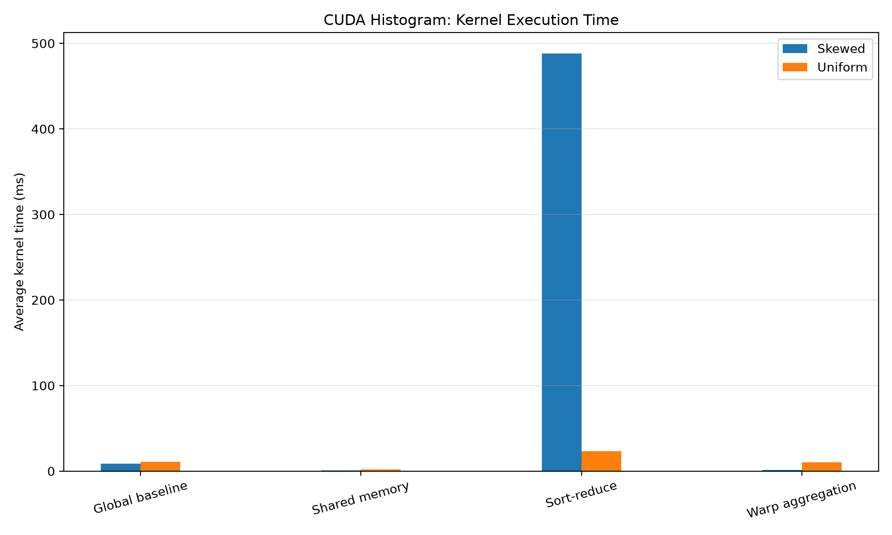
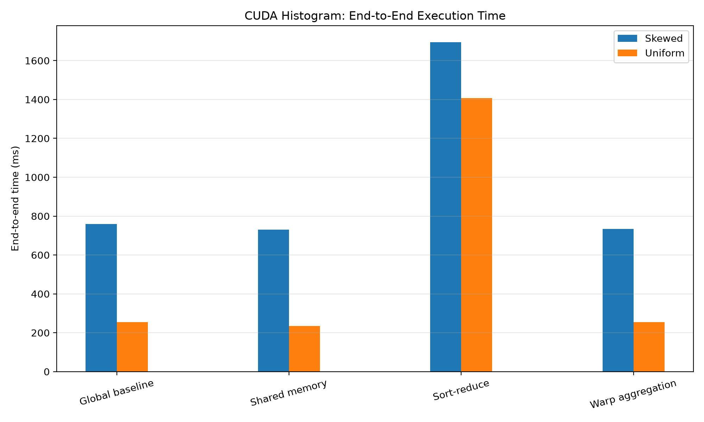

# GPU Histogram Benchmarking with CUDA

## Overview

This project implements and compares six GPU histogram computation strategies using NVIDIA CUDA. It investigates how algorithm design, input distribution, CUDA thread-block size, and execution environment affect kernel execution time and end-to-end performance.

The benchmark processes **32 million input values** and constructs a histogram with **256 bins**. Experiments use two input distributions—uniform and skewed—and compare results from Windows and Ubuntu running under WSL2 on the same NVIDIA GeForce RTX 3050 Laptop GPU with 6 GB of reported memory.

The project includes CUDA implementations, automated benchmark scripts, CSV datasets, performance visualizations, Nsight profiling reports, and a cross-platform analysis report.

## Benchmark Results at a Glance

The experiments evaluate six strategies, two input distributions, and three CUDA block sizes: 128, 256, and 512 threads.

This produces **36 configurations per platform**, with five repetitions per configuration in the Linux benchmark suite.

### Windows Performance Comparisons

The following plots present the Windows benchmark results.

**Kernel execution time**



**End-to-end execution time**



Kernel execution time and end-to-end execution time are different measurements. End-to-end timing may include additional processing and setup overhead, depending on the benchmark implementation.

### Cross-Platform Analysis

The `comparison_graphs/` directory contains strategy-specific comparisons between Windows and Linux/WSL2 for both input distributions.

The combined summary tables and plots help investigate performance differences across the tested configurations.

See [REPORT.md](REPORT.md) for the experimental methodology, selected measurements, profiling observations, limitations, and conclusions.

## Problem Definition

A histogram counts how many input elements belong to each bin.

For an input array \(x\), the histogram count for bin \(b\) is:

\[
H[b] = \sum_{i=0}^{N-1} \mathbf{1}(x_i=b)
\]

where:

- \(N\) is the number of input elements.
- \(b\) is a histogram bin.
- \(H[b]\) is the number of elements assigned to bin \(b\).
- \(\mathbf{1}(x_i=b)\) equals 1 when \(x_i=b\), and 0 otherwise.

The sum of all histogram bins should equal the number of input elements:

\[
\sum_{b=0}^{255} H[b] = 32{,}000{,}000
\]

This property is used as part of the benchmark's correctness checks.

## Implemented Strategies

The project compares six histogram computation approaches.

1. **Global Atomic Baseline** — Threads update histogram bins in global memory using atomic operations.
2. **Shared-Memory Privatization** — Blocks build local histograms in shared memory and subsequently merge their counts.
3. **Sort-and-Reduce** — Sorts input values and counts repeated values using a reduction-based approach.
4. **Warp Register Aggregation** — Combines updates to the same bin at the warp level before issuing histogram updates.
5. **Warp-Shared Hybrid** — Combines warp-level aggregation with shared-memory histogram construction.
6. **Per-Warp Shared-Memory Histogram** — Uses separate shared-memory histograms for individual warps before merging their results.

The CUDA implementations are located in `src/`, with their declarations in `include/`.

## Experimental Configuration

| Parameter | Configuration |
|---|---|
| Input size | 32,000,000 values |
| Histogram bins | 256 |
| Input distributions | Uniform and skewed |
| CUDA block sizes | 128, 256, 512 threads |
| Histogram strategies | 6 |
| Configurations per platform | 36 |
| Linux benchmark repetitions | 5 per configuration |
| Linux benchmark runs | 180 successful runs |

### Input Distributions

- **Uniform:** Values are distributed approximately evenly across the histogram bins.
- **Skewed:** Values are concentrated in a smaller portion of the range, increasing the potential for contention on frequently updated bins.

These distributions allow the implementations to be evaluated under different update patterns.

## Benchmarking and Analysis

The repository contains scripts and output files for benchmark execution, statistical summaries, and cross-platform comparisons.

### Windows benchmark files

- `run_benchmarks.py` — Automates the Windows benchmark suite.
- `benchmark_results.csv` — Individual Windows benchmark results.
- `benchmark_summary.csv` — Summarized Windows benchmark results.
- `results/` — Windows result visualizations.

### Linux/WSL2 benchmark files

- `run_benchmarks_linux.py` — Automates the Linux/WSL2 benchmark suite.
- `benchmark_results_linux.csv` — Individual Linux/WSL2 benchmark results.
- `benchmark_summary_linux.csv` — Summarized Linux/WSL2 benchmark results.
- `benchmark_failures_linux.txt` — Records benchmark failures; the completed suite reported no failed runs.

### Cross-platform analysis files

- `compare_platforms.py` — Generates cross-platform comparison outputs.
- `comparison_graphs/combined_platform_summary.csv` — Combined platform summary data.
- `comparison_graphs/best_block_sizes.csv` — Best measured block-size configurations for each platform, distribution, and strategy.
- `comparison_graphs/` — Generated comparison plots for all six strategies under both input distributions.

### Performance metrics

**Kernel execution time:** Measures the execution time of the histogram kernel.

**End-to-end execution time:** Measures a broader execution pipeline, potentially including allocation, data transfer, preprocessing, or other operations, depending on the benchmark implementation.

These metrics should be interpreted separately. A strategy with a fast kernel may still incur additional preprocessing or execution overhead.

For fair comparisons, the relevant timing metric and block-size configuration should be considered explicitly.

## Cross-Platform Performance Graphs

The following plots compare Windows and Linux/WSL2 measurements for each strategy.

### Uniform Input Distribution

**Strategy 1 — Global Atomic Baseline**


**Strategy 2 — Shared-Memory Privatization**


**Strategy 3 — Sort-and-Reduce**


**Strategy 4 — Warp Register Aggregation**


**Strategy 5 — Warp-Shared Hybrid**


**Strategy 6 — Per-Warp Shared-Memory Histogram**


### Skewed Input Distribution

**Strategy 1 — Global Atomic Baseline**


**Strategy 2 — Shared-Memory Privatization**


**Strategy 3 — Sort-and-Reduce**


**Strategy 4 — Warp Register Aggregation**


**Strategy 5 — Warp-Shared Hybrid**


**Strategy 6 — Per-Warp Shared-Memory Histogram**


The plots should be interpreted alongside the CSV summaries, which contain the measurements used for the comparisons.

## NVIDIA Nsight Profiling

NVIDIA Nsight Systems and Nsight Compute were used to investigate representative benchmark executions.

**Nsight Systems** helps inspect CUDA API activity, kernel execution, and memory-transfer activity.

**Nsight Compute** provides kernel-level information such as register usage, occupancy, throughput indicators, scheduler behaviour, and warp stall characteristics.

The collected profiling artifacts are stored in `reports/`. The available reports cover selected configurations rather than every possible benchmark configuration.

Profiler execution times are not substituted for normal benchmark timings because profiling and replay can introduce additional overhead.

The profiling observations provide evidence for investigating potential bottlenecks, but individual stall metrics do not necessarily establish a single definitive cause of poor performance.

## Building the Project

### Requirements

- NVIDIA GPU supporting the CUDA features used by the implementation.
- NVIDIA CUDA Toolkit compatible with the project.
- Compatible C++ compiler and build environment.
- CMake.

### Windows

From a suitable Windows development terminal, configure and build the project:

```bat
cmake -S . -B build
cmake --build build --config Release
```

Run an example benchmark:

```bat
build\benchmark_histogram.exe skewed 1 256
```

Run the Windows benchmark automation script:

```bat
python run_benchmarks.py
```

### Linux / WSL2

The project was also built and benchmarked in Ubuntu running under WSL2, using CUDA Toolkit 13.1.

Configure and build the Linux executable:

```bash
cmake -S . -B build-linux -DCMAKE_CUDA_ARCHITECTURES=86
cmake --build build-linux -j2
```

Run example benchmarks:

```bash
./build-linux/benchmark_histogram uniform 2 256
./build-linux/benchmark_histogram skewed 2 256
```

Run the Linux benchmark suite:

```bash
python3 run_benchmarks_linux.py
```

Regenerate the cross-platform comparison outputs:

```bash
python3 compare_platforms.py
```

The commands assume a compatible CUDA compiler, GPU architecture configuration, and CMake environment. Refer to `CMakeLists.txt` and the benchmark scripts for implementation-specific details.

## Results and Interpretation

The results support several important comparisons.

- **Input distribution:** Uniform and skewed inputs can produce substantially different execution times for the same strategy.
- **Block size:** The best measured block size can differ across strategies, distributions, and platforms.
- **Atomic contention:** Histogram updates may contend when many threads target the same bins.
- **Memory hierarchy:** Global-memory atomics, shared-memory privatization, and per-warp histograms have different synchronization and memory-access costs.
- **Preprocessing overhead:** Sort-and-reduce may incur substantial sorting and reduction costs, depending on the input distribution and implementation.
- **Execution environment:** Windows and Linux/WSL2 results can differ because of software configuration and execution conditions, even on the same physical GPU.

No single result should be interpreted without considering the input distribution, block size, and timing metric.

For the quantitative findings and final conclusions from the collected measurements, see [REPORT.md](REPORT.md).

## Project Structure

```text
gpu-histogram-benchmarking/
├── include/
│   └── CUDA header files
├── src/
│   ├── kernels.cu
│   └── main.cu
├── reports/
│   └── Profiling reports and environment information
├── results/
│   └── Windows result visualizations
├── comparison_graphs/
│   ├── combined_platform_summary.csv
│   ├── best_block_sizes.csv
│   └── Uniform and skewed comparison plots
├── CMakeLists.txt
├── README.md
├── REPORT.md
├── run_benchmarks.py
├── run_benchmarks_linux.py
├── compare_platforms.py
├── benchmark_results.csv
├── benchmark_summary.csv
├── benchmark_results_linux.csv
└── benchmark_summary_linux.csv
```

Generated build directories and additional profiling artifacts may be present in the repository beyond this simplified structure.

## Project Status

The project includes six CUDA histogram strategies, Windows and Linux/WSL2 benchmark results, cross-platform comparison graphs, CSV summaries, and selected Nsight profiling artifacts.

The completed experiments provide a basis for comparing strategy performance across input distributions, block sizes, and execution environments. The accompanying report documents the methodology, measured results, profiling observations, and limitations.

## Detailed Report

See [REPORT.md](REPORT.md) for the full cross-platform performance and profiling report, including selected measurements, interpretation, and conclusions.

## License

No license has been specified for this repository yet.


 
