# GPU Histogram Benchmarking with CUDA

## Overview

This project studies and compares different GPU histogram computation strategies implemented using NVIDIA CUDA.

The objective is to understand how different approaches to histogram construction affect kernel execution time and end-to-end performance under different input distributions and CUDA thread-block configurations.

The benchmark uses **32 million input values and 256 histogram bins**, with two input distributions: uniform and skewed.

## Problem Definition

A histogram counts how many input elements belong to each bin.

For an input array \(x\), the histogram count for bin \(b\) is:

\[
H[b] = \sum_{i=0}^{N-1} \mathbf{1}(x_i=b)
\]

where:
- \(N\) is the number of input elements.
- \(b\) is a histogram bin.
- \(H[b]\) is the number of elements assigned to bin \(b\).

The sum of all histogram bins should equal the number of input elements:

\[
\sum_{b=0}^{255} H[b] = 32{,}000{,}000
\]

This property is used as part of the correctness checks.

## Implemented Strategies

The project compares six histogram computation approaches:

1. **Global Atomic Baseline** — Threads update histogram bins in global memory using atomic operations.
2. **Shared-Memory Privatization** — Blocks build local histograms in shared memory and subsequently merge their counts.
3. **Sort-and-Reduce** — Input values are sorted and repeated values are counted using a reduction-based approach.
4. **Warp Register Aggregation** — Warp-level aggregation combines updates to the same bin before issuing histogram updates.
5. **Warp-Shared Hybrid** — Combines warp-level aggregation with shared-memory histogram construction.
6. **Per-Warp Shared-Memory Histogram** — Uses separate shared-memory histograms for individual warps before merging the results.

The implementations are located in `src/` with their declarations in `include/`.

## Experimental Configuration

| Parameter | Configuration |
|---|---|
| Input size | 32,000,000 values |
| Number of bins | 256 |
| Input distributions | Uniform and skewed |
| CUDA block sizes | 128, 256 and 512 threads |
| Strategies | 6 |
| Total configurations | 36 |

The configurations consist of six strategies evaluated across two distributions and three block sizes.

### Input Distributions

- **Uniform:** Values are distributed approximately evenly across the histogram bins.
- **Skewed:** Values are concentrated around a smaller portion of the bin range, increasing the potential for contention on frequently updated bins.

The distributions help evaluate how the different implementations behave under different update patterns.

## Benchmarking and Analysis

The project includes scripts and output files for performance measurement and analysis.

- `run_benchmarks.py` — Automates benchmark execution.
- `benchmark_results.csv` — Stores individual benchmark results.
- `benchmark_summary.csv` — Stores summarized benchmark results.
- `results/` — Contains generated result visualizations.
- `reports/` — Contains profiling reports and supporting experimental information.

Two important performance measures are considered:

**Kernel execution time:** Measures the execution time of the histogram kernel.

**End-to-end time:** Measures the broader execution pipeline, which may include operations beyond the kernel itself. The exact components depend on the benchmark implementation.

Kernel timings and end-to-end timings should be interpreted separately because a strategy with a fast kernel may still have additional preprocessing or execution overhead.

## NVIDIA Nsight Compute Profiling

Nsight Compute was used to collect GPU kernel profiling reports.

The profiling configuration includes both input distributions and all six strategies, using a block size of 256 threads.

The reports can be used to investigate:
- Kernel launch configuration.
- Compute and memory throughput indicators.
- Register usage.
- Occupancy-related information.
- Memory workload behavior.
- Warp execution and stall characteristics.
- Potential optimization opportunities.

Profiling overhead can affect measured execution time. Therefore, normal benchmark timings should be used for performance comparisons, while Nsight Compute reports should be used to investigate kernel behavior.

## Building the Project

Requirements:
- NVIDIA GPU supporting the CUDA features used by the implementation.
- NVIDIA CUDA Toolkit.
- A compatible C++ compiler and build environment.
- CMake.

From a suitable Windows development terminal, configure and build the project:

```bat
cmake -S . -B build
cmake --build build --config Release
```

The commands assume that the installed compiler, CUDA Toolkit and CMake configuration are compatible with the project.

## Running the Benchmark

Run the benchmark executable with the input distribution, strategy ID and block size:

```bat
build\benchmark_histogram.exe skewed 1 256
```

For example, the command requests the skewed distribution, strategy 1 and a block size of 256 threads.

Run the benchmark automation script to execute the configured experiments:

```bat
python run_benchmarks.py
```

Refer to the script and `CMakeLists.txt` for the exact supported arguments and build configuration.

## Results and Interpretation

The benchmark CSV files and plots are provided for examining the performance of the implemented strategies.

The analysis should consider:
- Differences between uniform and skewed input distributions.
- The effect of CUDA block size on kernel execution.
- The trade-off between kernel time and end-to-end time.
- The effects of atomic contention and memory access patterns.
- The additional overhead associated with sorting and reduction.

No single strategy should be assumed to perform best under every configuration without examining the measured results.

## Project Structure

```text
gpu-histogram-benchmarking/
├── include/
│   └── CUDA header files
├── src/
│   ├── kernels.cu
│   └── main.cu
├── reports/
│   └── Profiling reports and environment information
├── results/
│   └── Generated graphs
├── CMakeLists.txt
├── run_benchmarks.py
├── benchmark_results.csv
├── benchmark_summary.csv
└── README.md
```

The exact contents of the `reports/` and `results/` directories depend on the collected experiments.

## Project Status

The CUDA implementations have been built and benchmarked, and Nsight Compute profiling reports have been collected for the configured strategies and input distributions.

Further analysis focuses on validating the complete benchmark summary, interpreting profiling metrics, checking the generated visualizations and documenting the experimental findings.

## License

No license has been specified for this repository yet.


## Linux / WSL2 Support

The project was also built and benchmarked in Ubuntu running under WSL2 with CUDA Toolkit 13.1 on the same NVIDIA GeForce RTX 3050 Laptop GPU.

### Build

```bash
cmake -S . -B build-linux -DCMAKE_CUDA_ARCHITECTURES=86
cmake --build build-linux -j2
```

### Run a Benchmark

```bash
./build-linux/benchmark_histogram uniform 2 256
./build-linux/benchmark_histogram skewed 2 256
```

### Run the Benchmark Suite

```bash
python3 run_benchmarks_linux.py
python3 compare_platforms.py
```

## Cross-Platform Results

The benchmark suite evaluates six CUDA histogram strategies using uniform and skewed input distributions, with block sizes of 128, 256, and 512 threads.

The Windows and Linux/WSL2 results, summary tables, and comparison plots are available in this repository.

- [Linux benchmark results](benchmark_results_linux.csv)
- [Linux benchmark summary](benchmark_summary_linux.csv)
- [Combined platform summary](comparison_graphs/combined_platform_summary.csv)
- [Best block sizes](comparison_graphs/best_block_sizes.csv)
- [Detailed project report](REPORT.md)

### Performance Comparison Graphs

**Uniform input distribution**

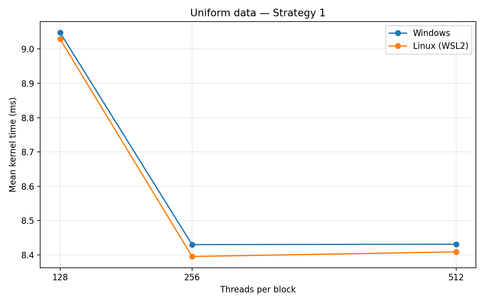

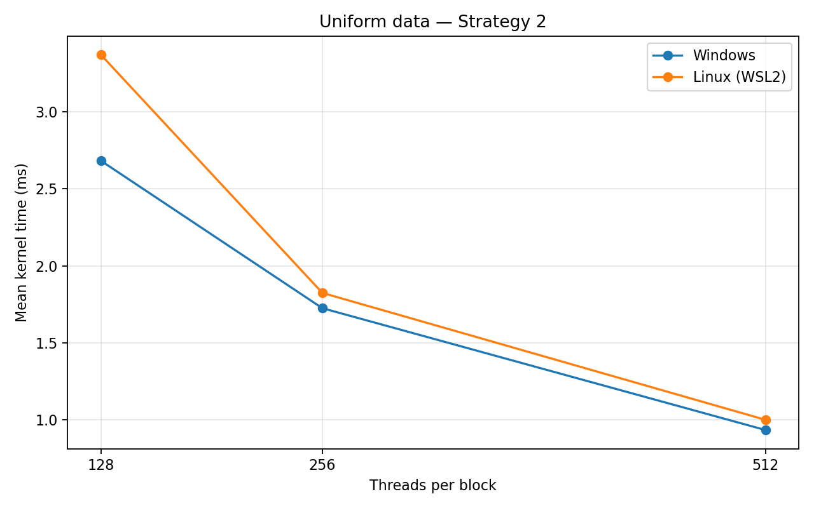

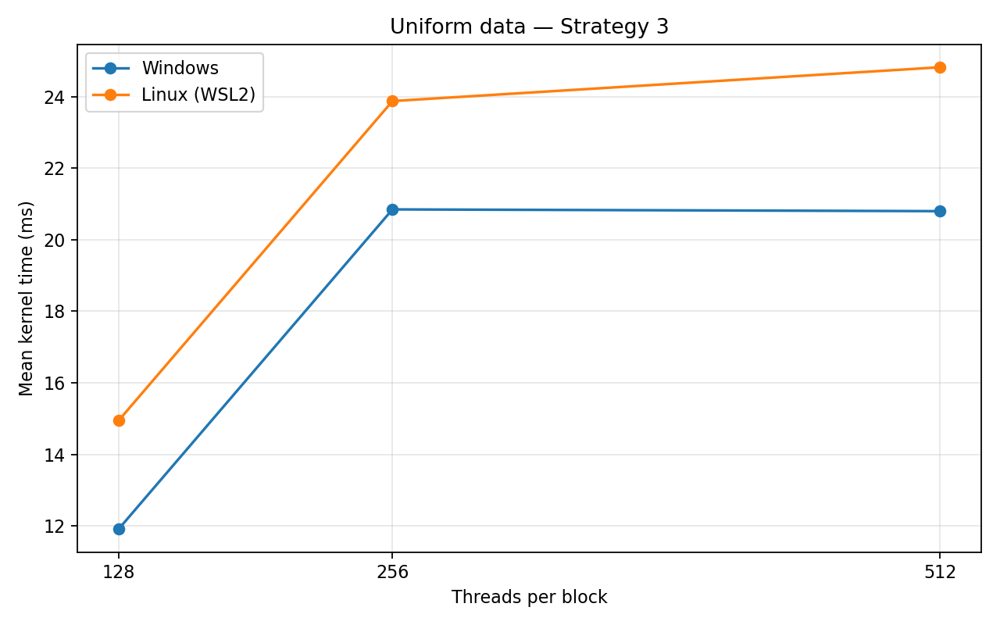

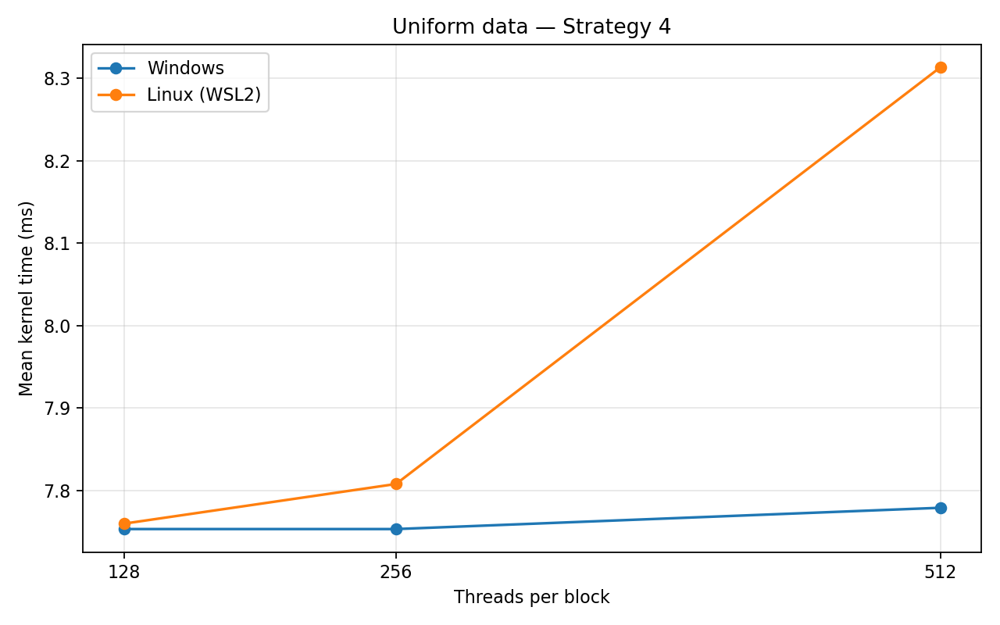

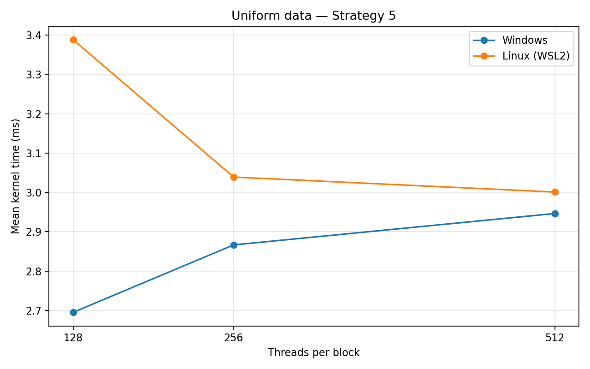

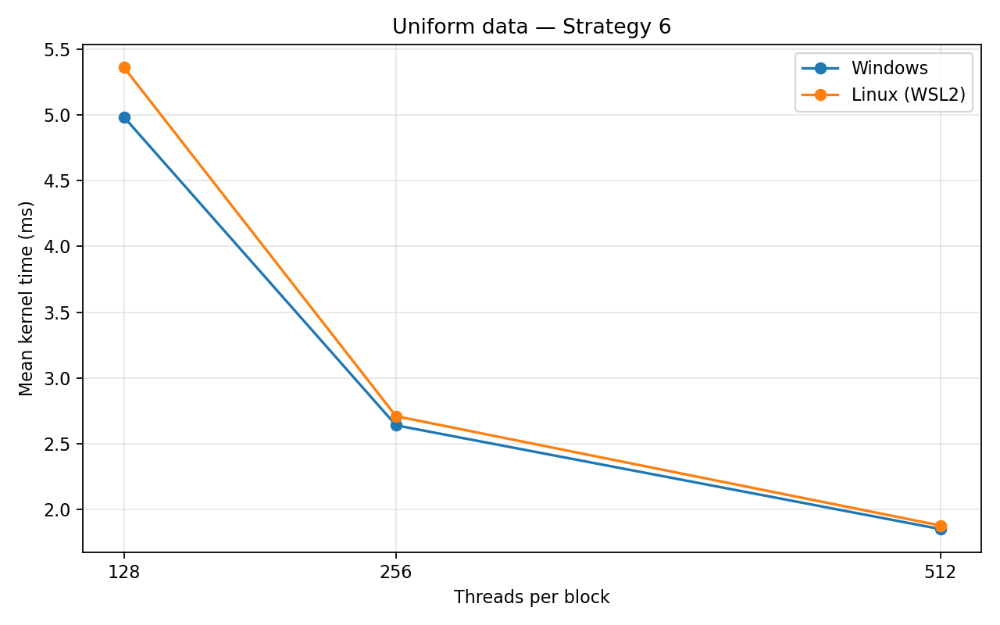

**Skewed input distribution**

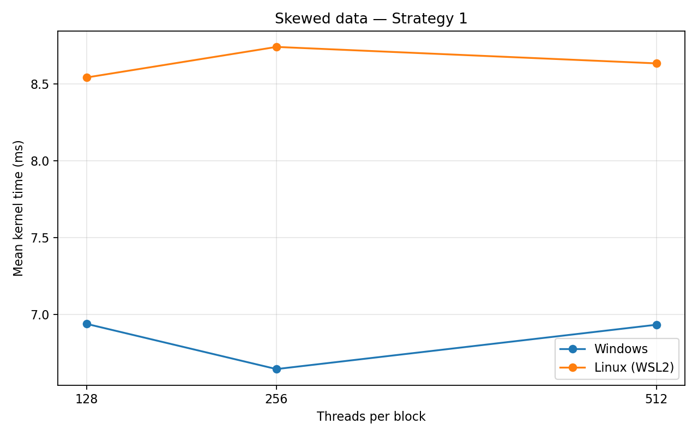

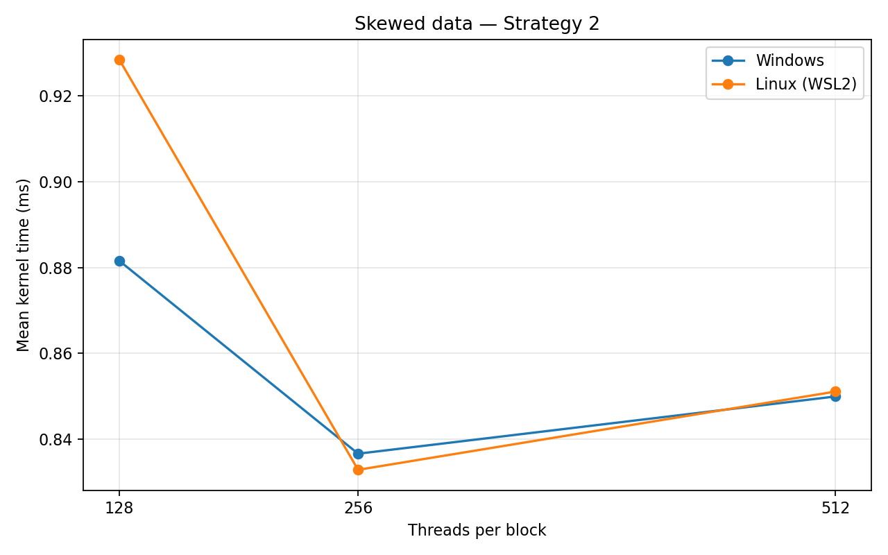

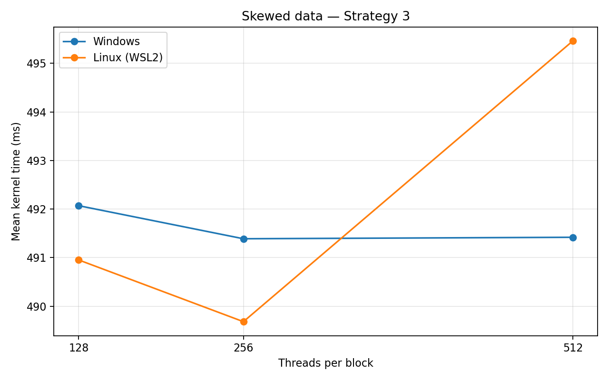

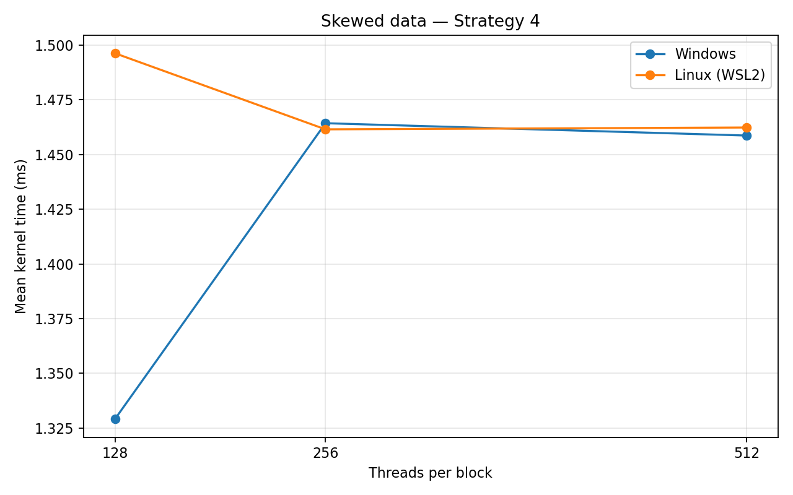

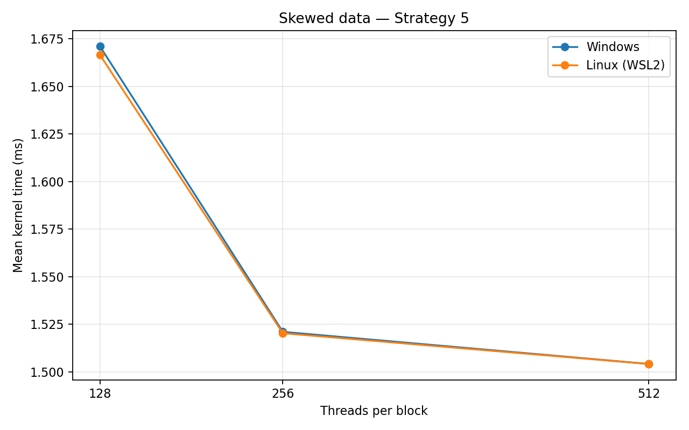

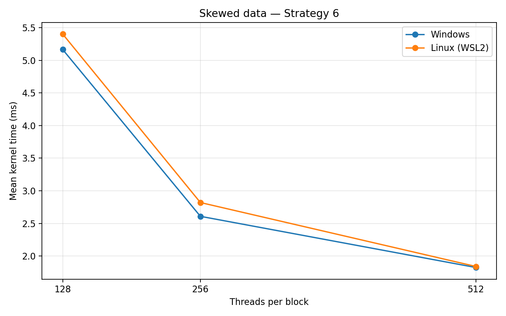

## Updated Project Status

Six CUDA histogram strategies have been implemented and benchmarked across two input distributions and three CUDA block sizes. The project includes Windows and Linux/WSL2 benchmark results, cross-platform comparison graphs, and Nsight profiling reports.

Measured performance depends on the input distribution, implementation strategy, block size, and execution environment. See [REPORT.md](REPORT.md) for the methodology, selected measurements, profiling observations, and experimental limitations.
